  

> Première version de l'API de suivi des navires : proxy EuRIS et gestion des jetons, en PHP.

  

**Statut** — 🟡 Première version, remplacée depuis par `trackship-backend` en Node.js

---

# TrackShip API

## Le problème

L'API EuRIS — le service européen d'information fluviale — ne peut pas être appelée directement depuis un navigateur : la clé serait exposée et le navigateur bloquerait la requête pour cause d'origine différente. Il faut un intermédiaire côté serveur.

## Ce que fait le projet

- Un proxy qui porte la clé côté serveur et renvoie au client uniquement ce dont il a besoin
- Un service d'authentification et un compteur d'appels, pour garder la consommation sous contrôle
- Une organisation MVC : contrôleurs, modèles, services séparés
- Deux fichiers `.htaccess`, un pour le développement et un pour la production

## Structure

`api/Controllers/` · `api/Models/` (Ship, Database, ExternalApi, Counter) · `api/Services/` (Auth, Counter, Euris) · `Dockerfile` · `index.html` et `token.html` les pages de test

## Lancer le projet

`docker build -t trackship-api . && docker run -p 8080:80 trackship-api`. La clé EuRIS se passe en variable d'environnement, jamais dans le code.

---

Développé par **Bakari Abidina** · [bakabi.fr](https://bakabi.fr)
